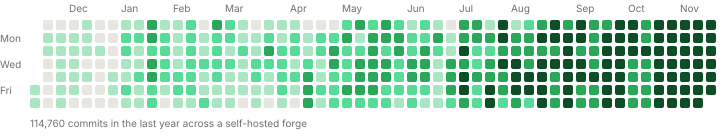

## Evan Haug

Electrical engineer turned software engineer. I build CAD automation for solar and electrical design at [Leaf Automation](https://leafautomation.ai): an AutoCAD plugin, a browser CAD studio, 3D routing and reinforcement-learning solvers. Chicago, IL.

### Leaf Automation Forge

Most of my work lives on a self-hosted code forge with its own CI, review and release pipeline, where LLM agents write most changes behind review gates.

| Repositories | Commits, all time | Commits, last 12 months | Pull requests and issues |
|---:|---:|---:|---:|
| 158 | 120,675 | 118,909 | 25,456 |

Top languages: Python 58%, TypeScript 14%, HTML 10%, JavaScript 7%, C# 5%, Swift 2%.

**Public stats page:** [forge.leafdesign.ai/assets/showcase](https://forge.leafdesign.ai/assets/showcase/index.html) (statistics only; source code stays private).

Refreshed 2026-11-23 from the forge's own history.
